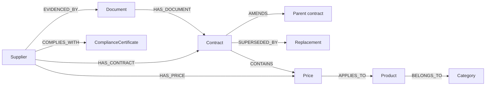

# Knowledge Graph and Graph RAG

This describes the graph that exists in this repository, not a target design.
Where a capability is absent it says so.

## 1. What it is

The graph is a **derived index**, not a second source of truth. It is built from
rows that ingestion already wrote (suppliers, contracts, amendments, products,
prices, compliance certificates, documents) and from document provenance. Deleting
a document removes its subgraph; re-indexing rebuilds it. The relational database
remains authoritative, and every graph edge that carries evidence also carries the
`document_id` (and `source_page` where known) it came from.



Node labels currently written: `Supplier`, `Contract`, `Amendment`,
`Product`, `Price`, `ComplianceCertificate`, `Document`, `Category`, `Clause`.
Relationship types: `HAS_CONTRACT`, `AMENDS`, `SUPERSEDED_BY`, `CONTAINS`,
`HAS_PRICE`, `APPLIES_TO`, `BELONGS_TO`, `COMPLIES_WITH`, `EVIDENCED_BY`,
`HAS_DOCUMENT`.

Temporal properties (`effective_date`, `expiry_date`, `version`,
`amendment_date`) are written on the edges that have them. They are stored and
readable; the retrieval layer does **not** yet use them to exclude superseded
prices from a historical question — see §6.

## 2. Providers

| Provider | When | Storage |
| --- | --- | --- |
| `local` | development, CI, this machine | SQLite at `var/graph.db`, two tables (`graph_nodes`, `graph_edges`) |
| `neo4j` | production | property graph; nodes keyed by `key` + `tenant_id`, relationships typed as real Cypher types |

Both implement one interface (`GraphProvider`): `upsert_nodes`, `upsert_edges`,
`delete_subgraph`, `neighbors`, `traverse`, `find_nodes`, `run_read_query`,
`counts`, `status`. Selecting the provider is configuration, not code.

`run_read_query` is a **documented read-only subset** (`cypher_subset.py`):
anchored `MATCH`, fixed or bounded relationship hops, simple `WHERE`, `RETURN`,
`LIMIT`. Anything outside it raises `UnsupportedQueryError`; write keywords are
rejected before execution. User-supplied Cypher is never passed through.

## 3. Guarantees, and where they are tested

`backend/tests/unit/test_graph_store_contract.py` covers the four properties the
rest of the system assumes:

- **tenant isolation** — traversal and node lookup filter by `tenant_id`; a
  tenant-A start node never returns a tenant-B edge. (An earlier
  `tests/security/test_tenant_isolation.py` case covers the same rule.)
- **bounded depth** — `max_hops` is enforced by the traversal, and the HTTP
  endpoints clamp it to 4.
- **overview consistency** — `counts()` reports `edges:<TYPE>` alongside the
  total. It previously returned only node labels, so `/graph/overview` showed
  `edges_total: 12` next to an empty `edges_by_type`.
- **provenance** — edges keep `document_id`, `source_page` and temporal
  properties, which is what makes a graph path citable.

## 4. How retrieval uses it

`app/retrieval/graph_retrieval.py` traverses from a resolved supplier and turns
each path into `CitationDraft`s pointing at the source document and page, so a
graph-derived statement is cited like any other. The agent requests a traversal
when the plan says `requires_graph` or resolves a supplier; results become a
`graph` block in the evidence bundle rather than an answer on their own.

Graph retrieval is **conditional**: it runs for relationship questions and
supplier-scoped questions, not for every request.

## 5. Interface

`GET /api/v1/graph/overview`, `/nodes`, `/nodes/{label}/{key}/neighbors` and
`/paths` all require `graph:read` and scope to the caller's tenant. The
`Relationships` workspace page reads those endpoints, with a textual table
fallback when the 3D scene is disabled.

## 6. Confirmed gaps

1. **MCP is not implemented.** There is no MCP server, no tool registry, and no
   `mcp` dependency in `pyproject.toml`. Part 8 of the brief is unimplemented,
   and nothing in the UI claims otherwise.
2. **Entity resolution is name-based.** Suppliers are matched on a normalised
   name; there is no identifier scheme, no merge review, and no candidate list.
3. **Historically incorrect edges were created before the name check.** Names
   such as "the council" and "any other party" became supplier rows because the
   party patterns accepted prose. Extraction now requires a capitalised,
   non-generic name (`metadata._looks_like_party_name`), but existing rows are
   untouched. `python scripts/audit_graph_entities.py` lists review candidates
   read-only; nothing is merged or deleted automatically.
4. **No graph evaluation.** There is no entity/relationship extraction accuracy
   set, no multi-hop recall measurement, and therefore no graph-vs-vector
   comparison. Claiming Graph RAG improves quality would be unsupported.
5. **Temporal filtering exists but is opt-in.** Traversal accepts an `as_of`
   date (`providers/graph/temporal.py`): an edge is skipped when its
   `effective_date` is later than that day or its `expiry_date` is earlier. It is
   available on `GET /graph/paths?as_of=` and on the MCP tool
   `get_entity_neighbours`, but the answer pipeline does not yet derive an as-of
   date from a question, so GraphRAG still traverses without one.
6. **Clause and obligation nodes are populated only from clause-tagged chunks.**
   The builder groups chunks by clause number, writes `Document -CONTAINS->
   Clause`, and adds an `Obligation` node with `Clause -IMPOSES-> Obligation`
   when the clause text contains a duty verb (`shall`, `must`, `agrees to`, …).
   That detection is lexical, not legal interpretation, and the property says so.
   Clause references are detected in prose too (`3.2 The Supplier shall…`) and a
   unit spanning several clauses is chunked per clause, so labels are not shared
   across boundaries. Documents indexed before this change have no clause nodes
   until they are re-indexed; a document that uses no clause numbering — such as
   the imported tender notices — still produces none, which is reported rather
   than invented.

## 7. Reproducing the current state

```bash
cd backend
python scripts/audit_graph_entities.py --db var/epi.db      # read-only
python -m pytest tests/unit/test_graph_store_contract.py -q
curl -s localhost:8000/api/v1/graph/overview -H "Authorization: Bearer $TOKEN"
```

At the time of writing the graph holds 31 nodes (4 suppliers, 1 contract,
20 documents, 6 compliance certificates, 0 products/prices/amendments) and 12
edges for the imported corpus, which is why the interface reports those counts
rather than a fuller picture.
