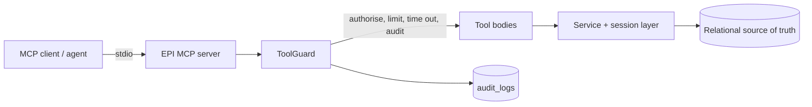

# MCP Architecture

This describes the MCP server that exists in this repository and the boundaries
it enforces. It uses the official Model Context Protocol Python SDK
(`mcp>=1.21`, already installed in this environment) over stdio.

## 1. Position in the system

MCP is an **interoperability boundary**, not a second API. The tools call the
same session and service layer the HTTP API uses, so tenant scoping, access-level
filtering and audit behaviour are identical on both paths. High-frequency
internal work (retrieval inside the agent) deliberately does not route through
MCP.



## 2. Identity is deployment configuration

The process serves exactly one tenant and one account:

| Variable | Meaning |
| --- | --- |
| `MCP_ENABLED` | must be `true` or the server refuses to start |
| `MCP_TENANT_ID` | tenant every query is scoped to |
| `MCP_USER_EMAIL` | account tool calls are attributed to |
| `MCP_ROLE` | role whose permissions apply (`admin`, `procurement_manager`, `buyer`, `compliance`, `viewer`) |
| `MCP_TOOL_TIMEOUT_SECONDS` | per-call budget, default 20 |
| `MCP_RATE_LIMIT_PER_MINUTE` | per-tool budget, default 60 |

This is the central security decision: the model can choose *which* tool to call
and with which arguments, but **cannot choose whose data it reads**. A missing
tenant or account is a startup error, not a default. There is no client-supplied
tenant parameter anywhere in the tool schemas.

## 3. Tools

All seven are read-only.

| Tool | Permission | Returns |
| --- | --- | --- |
| `search_documents` | `documents:read` | documents matching a title or file name |
| `get_document` | `documents:read` | status, type, version, dates, links |
| `search_contracts` | `contracts:read` | contracts matching a number or title |
| `get_supplier_profile` | `suppliers:read` | supplier with contracts and counts |
| `get_contract_amendments` | `contracts:read` | amendments recorded against a contract |
| `get_ingestion_status` | `documents:read` | recent jobs with their documents |
| `get_evaluation_metrics` | `evaluation:read` | completed runs and recorded metrics |
| `search_graph` | `graph:read` | graph entities by label and name |
| `get_entity_neighbours` | `graph:read` | typed relationships, optionally as of a date |

Deliberately absent, and not pending work: unrestricted SQL, filesystem access,
arbitrary graph queries, and any create/update/delete tool. Uploads, re-indexing
and deletion stay on the authenticated HTTP API where the request is tied to a
human session and a CSRF-checked origin.

## 4. Guarantees

Implemented in `app/mcp_server/guards.py` and covered by
`tests/unit/test_mcp_server.py`:

- **Authorisation before work.** Each tool declares a permission; the call is
  rejected first, and the denial is audited with the role and permission.
- **Timeout.** `asyncio.wait_for` bounds every call; a timeout is audited.
- **Rate limit.** A per-tool sliding one-minute window; exceeding it is audited.
- **Audit.** Every call writes an `audit_logs` row through
  `record_principal_action` with `resource_type="mcp_tool"` and the outcome
  (`success`, `denied`, `timeout`, `rate_limited`, `error`). Audit failures never
  break a tool call.
- **Output validation.** Results must be JSON-serialisable, so an ORM object or
  internal handle cannot leak through the boundary.
- **No existence disclosure.** `get_document` answers identically for a document
  that does not exist and one in another tenant.

## 5. Running it

```bash
cd backend
MCP_ENABLED=true \
MCP_TENANT_ID=ten_e429fecae1234589ac7c999af5b3eb70 \
MCP_USER_EMAIL=tools@epi.local \
MCP_ROLE=viewer \
python -m app.mcp_server
```

Without valid configuration it exits with status 2 and prints the missing
variable. It has not been registered with any external client in this
environment, and no client-side integration is claimed.

### Verified over the wire

`scripts/verify_mcp_stdio.py` spawns the server as a subprocess, performs the
protocol handshake, checks the advertised tool set, calls `get_ingestion_status`,
`search_documents`, `search_graph` and `get_entity_neighbours`, and (with
`--role viewer`) confirms a call the role may not make is refused. On the imported
corpus the handshake advertises **nine** tools, all list and read calls return
data, and a viewer is refused `search_graph` with `lacks permission 'graph:read'`.

The same handshake runs as `tests/integration/test_mcp_stdio.py` when
`EPI_MCP_STDIO=1` is set.

## 6. Gaps

1. **No external connectors.** The brief's storage, procurement-source and
   GitHub connectors do not exist; only internal workspace tools do.
2. **Graph access is read-only and label-allowlisted.** Two tools expose entity
   search and neighbourhood traversal, with tenant scoping and an optional as-of
   date; there is no Cypher tool and no write.
3. **Stdio only.** There is no HTTP/SSE transport, so remote agents cannot
   connect without a supervisor process.
4. **Rate limiting is per process.** Two server processes have two budgets.
5. **The wire test is opt-in.** A real client handshake is implemented and
   passing, but as `EPI_MCP_STDIO=1` rather than part of the default suite, since
   it starts a subprocess and reads the local database.
